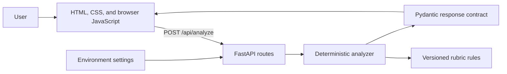

# Architecture

## Current shape

System Prompt Analyzer is a small server-rendered web application with a JSON API and a local,
deterministic analysis domain.



## Request flow

1. The browser submits prompt text as JSON.
2. FastAPI validates the request length and type.
3. The analyzer preserves meaningful source-line numbers.
4. Every rubric rule is checked for applicability.
5. Applicable rules are matched against prompt lines for evidence.
6. The analyzer creates exactly one finding per rule.
7. Missing findings become gap nodes for the visual map.
8. Pydantic enforces response invariants before serialization.
9. The browser renders nodes using text-only DOM APIs to avoid interpreting prompt content as HTML.

## Source layout

```text
src/system_prompt_analyzer/
├── analyzer.py       # deterministic evaluation and visual-map projection
├── config.py         # environment-based settings
├── main.py           # application construction and HTTP routes
├── rubric.py         # executable versioned rubric definition
├── schemas.py        # public request, response, and domain invariants
├── static/           # browser CSS and JavaScript
└── templates/        # server-rendered HTML shell
tests/
├── fixtures/prompts/ # representative acceptance examples
├── test_app.py       # HTTP behavior
└── test_rubric.py    # rubric and contract behavior
```

## Responsibility boundaries

- **Rubric:** defines what is evaluated and why.
- **Analyzer:** applies the rubric and converts results into the visual-map projection.
- **Schemas:** protect the public contract and its invariants.
- **Routes:** translate HTTP requests to domain calls without embedding analysis decisions.
- **Browser:** submits text and presents results; it does not determine prompt quality.

## Why both findings and nodes exist

Findings are the stable analysis contract. Nodes and edges are a presentation projection. Keeping
them separate allows the visual interface to evolve into a graph without weakening the analysis
data or forcing API consumers to reconstruct findings from UI objects.

## Configuration

Configuration is loaded from environment variables and optional `.env` values by
`pydantic-settings`. Secrets are never returned by the configuration endpoint. The current
provider settings are dormant until the model-backed increment.

## Persistence and external calls

The current application has no database, user accounts, telemetry, or model API call. Prompt text
is held only for the duration of a request and rendered in the current browser page. Standard web
server and infrastructure behavior may differ when the app is deployed; see the privacy guide.

## Planned evolution

The next infrastructure boundary will be one model-provider client. It will produce the same
finding schema. A later orchestration step will merge deterministic and model findings while
preserving provenance. No provider abstraction hierarchy is introduced until there is a second
real provider to support.
